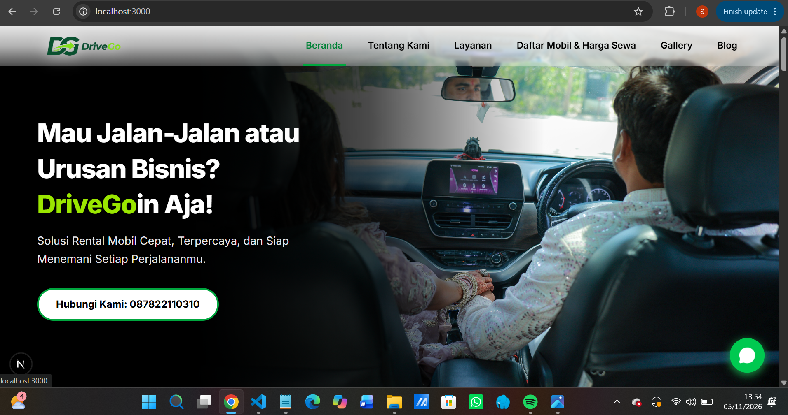
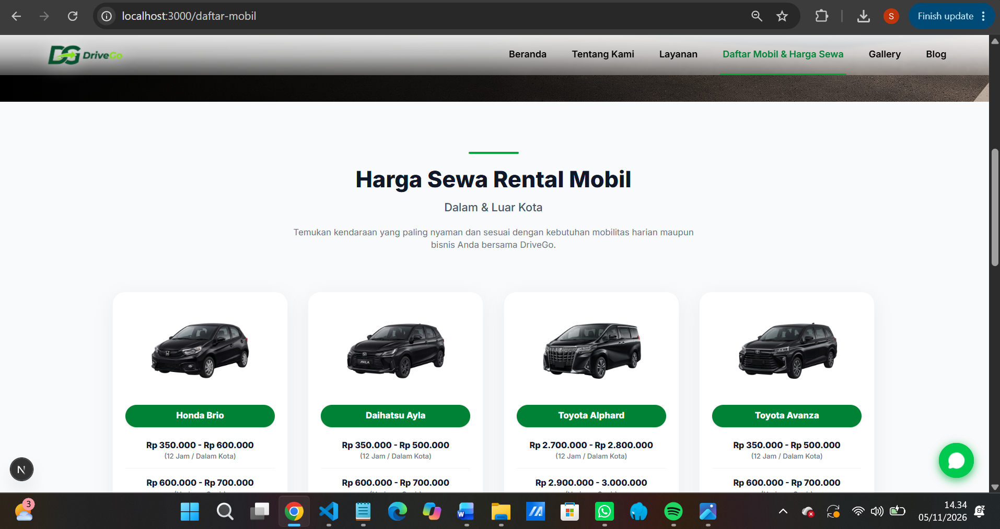

# 🚗 DriveGo - Modern Car Rental Website

DriveGo adalah platform *website* rental mobil modern, responsif, dan profesional yang dirancang untuk memudahkan pelanggan mencari dan menyewa kendaraan dengan cepat melalui integrasi WhatsApp langsung.

## 📸 Tampilan Website

*Halaman Beranda:*


*Halaman Katalog Mobil:*


## 🚀 Teknologi yang Digunakan

Website ini dibangun menggunakan *tech-stack* mutakhir untuk memastikan performa yang sangat cepat (SEO Friendly) dan pengalaman UI/UX yang mulus:

*   **Framework:** [Next.js 16](https://nextjs.org/) (App Router & Turbopack)
*   **Library UI:** [React](https://reactjs.org/)
*   **Styling:** [Tailwind CSS](https://tailwindcss.com/)
*   **Icons:** [Lucide React](https://lucide.dev/)
*   **Bahasa Utama:** TypeScript / JavaScript (ES6+)

## ✨ Fitur Utama
*   **Desain Responsif:** Tampil sempurna dan rapi di layar HP, Tablet, maupun Desktop.
*   **Katalog & Blog Dinamis:** Halaman detail mobil dan artikel blog di-render secara dinamis menggunakan *Dynamic Routing* (`[slug]`).
*   **Optimasi Kecepatan (Prerendering):** Menggunakan kombinasi Server Components dan `generateStaticParams` untuk menghindari *blocking route* dan mempercepat *loading* halaman.
*   **WhatsApp Integration:** Tombol "Pesan Sekarang" secara cerdas menangkap nama mobil yang sedang dilihat dan merakit pesan otomatis ke WhatsApp Admin.
*   **Global Layout & Floating Action:** *Navbar* transparan dan tombol *chat* WhatsApp melayang yang konsisten di seluruh halaman aplikasi.

## 💻 Cara Menjalankan Project di Komputer Anda

1. Clone repository ini:
   ```bash
   git clone [https://github.com/BANYUss/drivego-website.git](https://github.com/BANYUss/drivego-website.git)